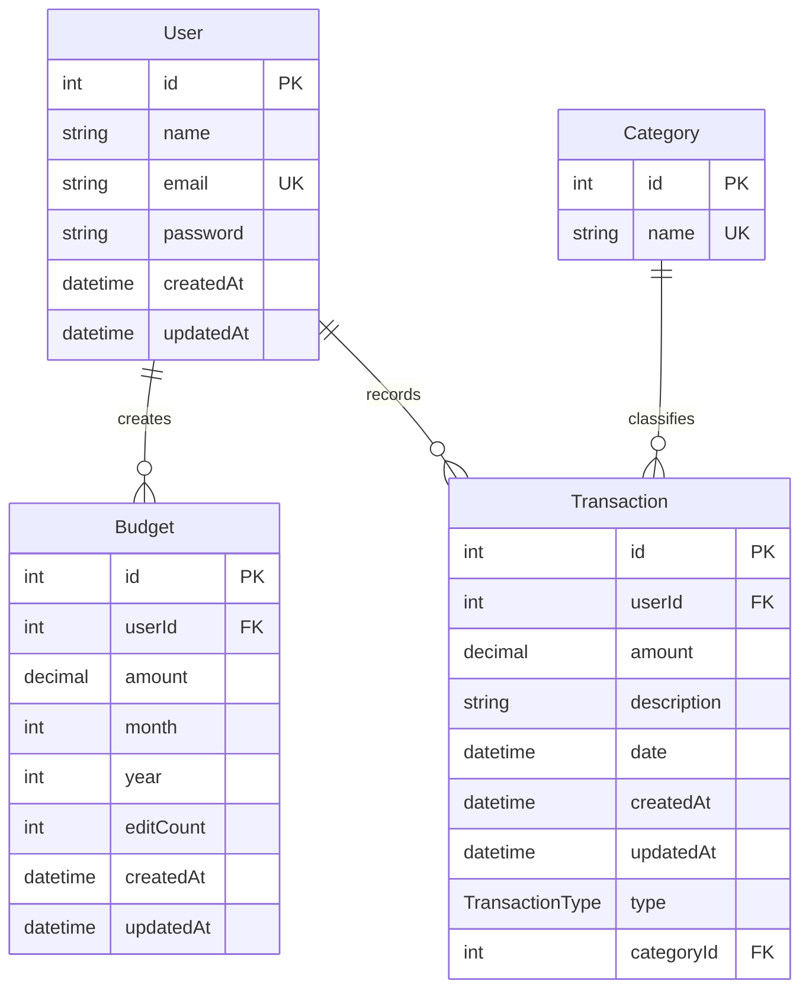

# Muneem – Database Entity Relationship Documentation

## 1. Overview

Muneem uses a PostgreSQL relational database managed through Prisma ORM.

The database currently contains four entities:

1. **User** – Stores registered user information.
2. **Budget** – Stores monthly budgets created by users.
3. **Transaction** – Stores income and expense records.
4. **Category** – Stores transaction categories.

## 2. Entity Relationship Diagram (ERD)



## 3. Entity Details

### 3.1 User

Stores registered user information.

| Field | Data Type | Constraint |
|---|---|---|
| id | Integer | Primary Key, Auto Increment |
| name | String | Required |
| email | String | Unique, Required |
| password | String | Required |
| createdAt | DateTime | Default: Current Timestamp |
| updatedAt | DateTime | Automatically Updated |

**Relationships:**
- One user can have multiple budgets.
- One user can have multiple transactions.

### 3.2 Budget

Stores monthly budget information for each user.

| Field | Data Type | Constraint |
|---|---|---|
| id | Integer | Primary Key, Auto Increment |
| userId | Integer | Foreign Key |
| amount | Decimal(14,2) | Required |
| month | Integer | Required |
| year | Integer | Required |
| editCount | Integer | Default: 0 |
| createdAt | DateTime | Default: Current Timestamp |
| updatedAt | DateTime | Automatically Updated |

**Relationships:**
- Each budget belongs to one user.
- A user can create multiple budgets.

**Unique Constraint:**
`(userId, year, month)`

This ensures that a user cannot have multiple budgets for the same month and year.

### 3.3 Transaction

Stores income and expense records.

| Field | Data Type | Constraint |
|---|---|---|
| id | Integer | Primary Key, Auto Increment |
| userId | Integer | Foreign Key |
| amount | Decimal(14,2) | Required |
| description | String | Required |
| date | DateTime | Default: Current Timestamp |
| createdAt | DateTime | Default: Current Timestamp |
| updatedAt | DateTime | Automatically Updated |
| type | TransactionType | Required |
| categoryId | Integer | Foreign Key |

**Relationships:**
- Each transaction belongs to one user.
- Each transaction belongs to one category.
- One user can have multiple transactions.
- One category can be associated with multiple transactions.

### 3.4 Category

Stores categories used to classify transactions.

| Field | Data Type | Constraint |
|---|---|---|
| id | Integer | Primary Key, Auto Increment |
| name | String | Unique, Required |

**Relationships:**
- One category can classify multiple transactions.
- Each transaction must reference one category.

## 4. Entity Relationships

| Relationship | Cardinality | Description |
|---|---|---|
| User → Budget | One-to-Many (1:N) | One user can create multiple budgets. |
| User → Transaction | One-to-Many (1:N) | One user can record multiple transactions. |
| Category → Transaction | One-to-Many (1:N) | One category can classify multiple transactions. |

## 5. Database Enums

### TransactionType

Defines the type of financial transaction.

```prisma
enum TransactionType {
  INCOME
  EXPENSE
}
```

### PaymentMethod

Defines available payment methods.

```prisma
enum PaymentMethod {
  CASH
  UPI
  CARD
  BANK_TRANSFER
  OTHER
}
```

**Note:** PaymentMethod is currently defined in the schema but is not yet connected to any model.

## 6. Referential Integrity and Constraints

| Constraint | Implementation |
|---|---|
| User email uniqueness | `@unique` |
| Category name uniqueness | `@unique` |
| Monthly budget uniqueness | `@@unique([userId, year, month])` |
| User deletion | Cascade deletion of related budgets and transactions |
| Category deletion | Restricted when related transactions exist |

## 7. Important Database Design Notes

1. Categories are currently global, not individually owned by users.
2. Transactions are directly associated with users.
3. There is currently no separate Account entity.
4. PaymentMethod is defined but not currently used by Transaction.
5. Budget records are associated with a user and a specific month and year.

---

**Technology Stack**

- Database: PostgreSQL
- ORM: Prisma
- Application: Next.js + TypeScript

**Document:** Muneem Database Design  
**Version:** Current Prisma Schema